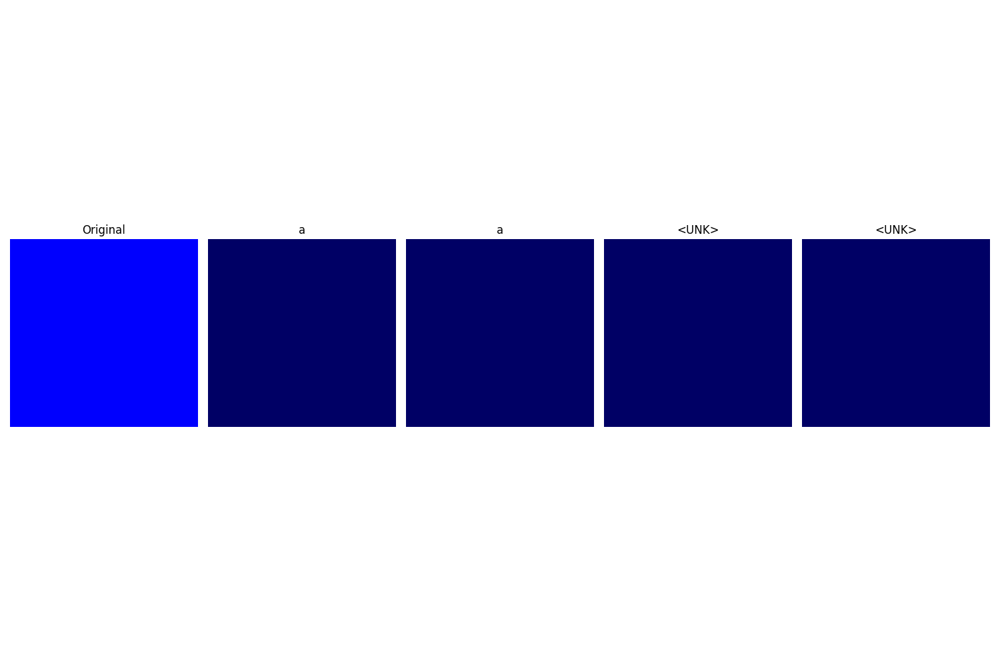

# Image Captioning using Attention Mechanism

An end-to-end Deep Learning system that generates descriptive captions for images using **Convolutional Neural Networks (CNN)** and **Recurrent Neural Networks (RNN)** equipped with **Visual Attention (Bahdanau Additive Attention)**. Built with PyTorch and featuring an interactive Flask web interface.



---

## Architecture Overview

1. **Encoder (ResNet-101)**:
   - Pretrained ResNet-101 CNN backbone (fine-tuned / adaptive pooled to 14x14).
   - Extracts rich 2048-dimensional spatial feature representations across image regions.

2. **Bahdanau Attention Mechanism**:
   - Calculates dynamic attention weights for each spatial grid cell at every decoding step.
   - Allows the decoder to focus selectively on relevant image areas for each predicted word.

3. **Decoder (LSTM with Attention)**:
   - Word embedding layer combined with attention-weighted context vectors.
   - Generates natural language descriptions sequentially until `<END>` token or max length.

---

## Project Structure

```
DeepLearning/
│
├── config.py             # Hyperparameters, paths, and device configurations
├── vocabulary.py         # Tokenization and vocabulary mapping
├── dataset.py            # Flickr8k dataset loader, custom collation, and DataLoader
├── models.py             # ResNet101 Encoder, Bahdanau Attention, Attention LSTM Decoder
├── train.py              # Training loop with teacher forcing and checkpoint saving
├── evaluate.py           # Evaluation script computing BLEU-1, BLEU-2, BLEU-3, BLEU-4
├── caption.py            # CLI inference & attention heatmap visualization
├── app.py                # Flask web application for interactive image captioning
├── requirements.txt      # Python dependencies
├── output_attention.png  # Sample attention visualization output
│
├── templates/
│   └── index.html        # Web interface UI
├── static/
│   ├── uploads/          # User-uploaded images
│   └── outputs/          # Generated attention maps
├── checkpoints/          # Saved model weights (best_model.pth.tar)
└── data/                 # Dataset folder (Flickr8k)
```

---

## Installation & Setup

### 1. Clone the Repository
```bash
git clone https://github.com/sidhusudharshan17-sid/image-captioning.git
cd image-captioning
```

### 2. Create a Virtual Environment
```bash
python -m venv venv
# On Windows:
venv\Scripts\activate
# On Linux / macOS:
source venv/bin/activate
```

### 3. Install Dependencies
```bash
pip install -r requirements.txt
```

### 4. Dataset Setup (Flickr8k)
Place the Flickr8k dataset files in `./data/flickr8k/`:
```
data/
└── flickr8k/
    ├── Images/          # JPEG images
    └── captions.txt     # Image name to caption mappings
```

---

## Usage

### Run the Interactive Web UI
Launch the Flask application to upload any image and view predicted captions along with step-by-step visual attention heatmaps:
```bash
python app.py
```
Open your browser and navigate to `http://localhost:5000`.

### Training
Train the CNN-RNN attention model:
```bash
python train.py
```
Checkpoints will be saved to `./checkpoints/best_model.pth.tar`.

### Evaluation
Compute BLEU scores on the test set:
```bash
python evaluate.py
```

### Command-Line Caption Inference
Generate a caption and save visual attention maps for a single image:
```bash
python caption.py --image path/to/image.jpg --model checkpoints/best_model.pth.tar
```

---

## Model Evaluation Metrics

Evaluated on the Flickr8k benchmark using corpus BLEU metrics:
- **BLEU-1**: Evaluates unigram overlap (vocabulary relevance)
- **BLEU-2**: Evaluates bigram consistency
- **BLEU-3**: Evaluates trigram structure
- **BLEU-4**: Evaluates 4-gram natural fluency

---

## License

This project is licensed under the MIT License.
